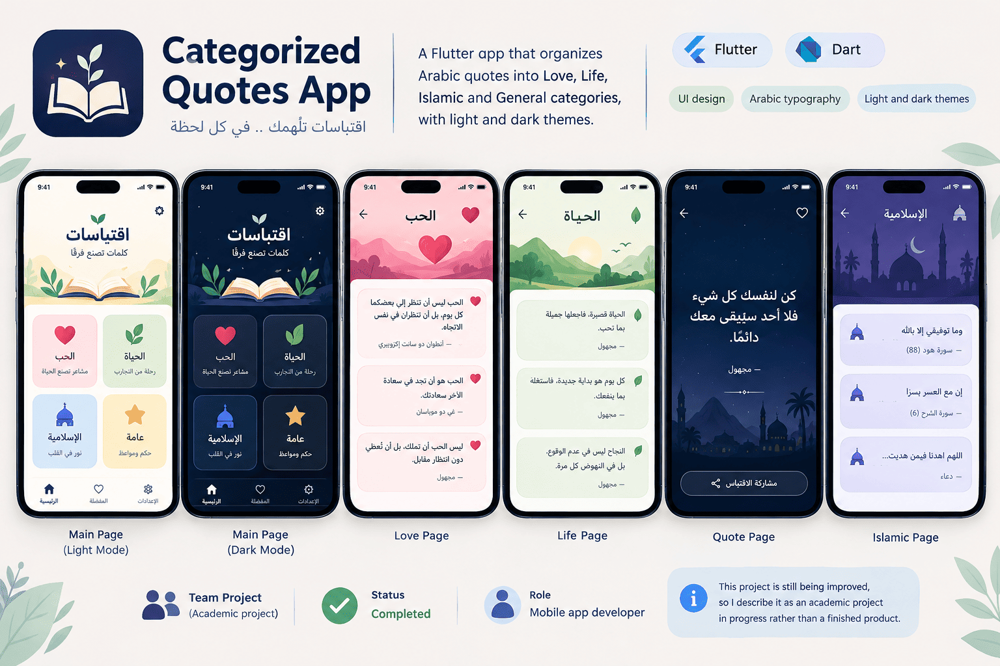

# Categorized Quotes App

A Flutter app that organizes Arabic quotes into categories, with light and dark themes.



## Features

- Quotes grouped into Love, Life, Quotes and Islamic categories
- Category-based navigation
- Light and dark themes
- Custom Arabic typography for readability

## Built with

Flutter · Dart

## Run it

```bash
flutter pub get
flutter run -d chrome   # web
flutter test
```

Requires the [Flutter SDK](https://docs.flutter.dev/get-started/install).

## Adding quotes

Quotes live in `lib/data/categories.dart`. Add a string to a list and it appears on the page.

## Author

Ahmed Ibrahim Mohamed Kamel · [GitHub](https://github.com/AhmedShosha3) · [LinkedIn](https://www.linkedin.com/in/ahmed-shosha-212192296/)
